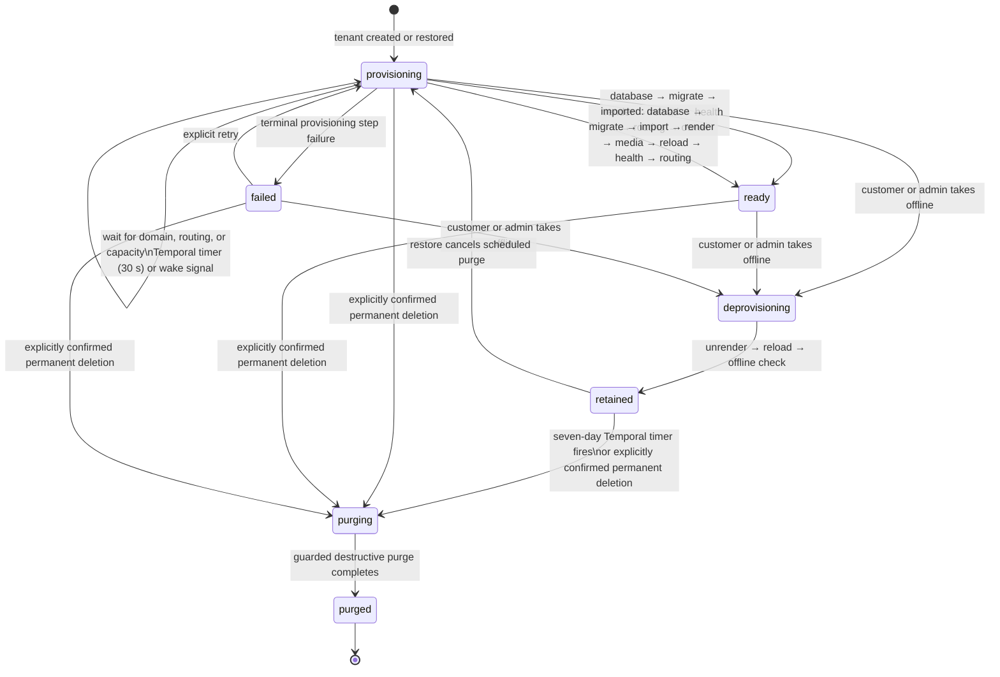

# Tenant lifecycle

PostgreSQL is the source of truth for tenant state. Temporal records durable
workflow progress and timers; it never replaces the tenant row as the authority.
The provision, deprovision, and purge operations are audited separately.

## One list of steps, two kinds of tenant

The workflow iterates every step a tenant can have, in the only order they make
sense in. A tenant without one completes it without running anything: a created
tenant has no `import` or `media`, and an imported one has no `owner`, because
its owner account arrived with its database. Which steps a tenant has is decided
once, in PostgreSQL, when it is created or imported.

Adding a step to that list changes what a replay of an already-running
provision workflow expects. A workflow parked in a wait — the common long-lived
case, an instance whose custom domain has not validated — is unaffected, because
nothing after the step it is waiting on has run yet. One that is midway through
its steps at the moment the control plane restarts is not: deploy while no
tenant is actively provisioning, or expect that workflow to need a retry.

The two kinds also wait for opposite things. A created instance with a custom
domain provisions nothing until that domain validates, so an instance whose
domain never validates leaves nothing behind. An imported instance is restored,
rendered, served and checked *first*, and waits only at `routing` — because its
domain is already serving somewhere else, and moving it is the cutover. The
health check reaches the runtime directly with a `Host` header, so it proves the
instance works before any public DNS points at it.

## Durable waiting and retrying

- A provision step that is not ready returns a durable wait outcome. Temporal
  persists a 30-second timer and rechecks that same step; earlier completed
  steps are skipped idempotently.
- `import` and `media` are bounded by how much of somebody's server there is
  rather than by work, so they are given twelve hours instead of five minutes
  and heartbeat every twenty seconds. The heartbeat is what keeps a long
  deadline from also being how long a crashed worker goes unnoticed: a step
  that goes quiet for two minutes gives up that attempt.
- A domain activation or lifecycle change sends a best-effort Temporal signal
  to wake the provision workflow immediately. Missing a signal is safe because
  the persisted timer remains.
- Unexpected activity failures use Temporal activity retry. Expected terminal
  provisioning errors are recorded on the tenant, step, and operation instead.
- Long-running provision workflows use continue-as-new after 240 timed waits,
  preventing unbounded workflow histories.

## Keeping a ready tenant on its configuration

The lifecycle workflows above each run once and end. One workflow does not:
`RuntimeReconcileWorkflow` exists for as long as its runtime does, and is what
makes a configuration change reach a tenant that is already serving.

Every write to `tenant_configuration` bumps the tenant's `config_revision`
through a database trigger, and a render records the revision it came from in
`rendered_revision`. The two differing is the only definition of drift. Once a
minute the workflow renders every ready tenant on its runtime whose revisions
differ, then reloads the runtime once for all of them — a reload makes the
runtime re-read its whole tenants directory, so a fleet that drifted together
costs one signal — and health-checks each tenant it touched.

The workflow ID is fixed per runtime, `runtime-reconcile-v1-<runtime id>`, so
the server refuses a duplicate and only one pass is ever in flight. The starter
asserts the workflow exists rather than queueing work for it, which is why
reconciliation has no outbox row: it is a controller, not an operation.

What it will not touch:

- A tenant that is not `ready` and `running`. One still provisioning has its own
  workflow rendering and reloading it; a retained or purging one was taken off
  disk deliberately.
- A runtime on another host. Only the control plane named by
  `CONTROL_RUNTIME_HOST` reconciles a runtime, and the render refuses anyway.
- A tenant that has failed five consecutive passes. The count and the reason sit
  on the tenant row, and an operator's render clears both.

A failed render does not hold back the reload for the rest of the runtime. A
failed reload does: every tenant rendered in that pass gives up its
`rendered_revision`, because a render that recorded its revision would leave no
drift for the next pass to find. Each pass writes one `reconcile` operation per
tenant, with no `requested_by`, which is what tells it apart from an operator's
render in the operations log.

## Watching an execution

The tenant inventory in `/admin` shows the durable workflow kind and the step
it is waiting on, taken from PostgreSQL. When `TEMPORAL_UI_URL` is configured,
that summary also links to the execution in the Temporal UI for history and
timers. The link is the only thing the console borrows from Temporal: workflow
input, activity results, and history stay in the Temporal UI, behind its own
private network, and never pass through this API. PostgreSQL remains the record
an operator acts on.

## Retention and destructive purge

Deprovisioning is deliberately non-destructive. A tenant reaches `retained`
only after it is offline; its database, media, configuration, backups, and
Cloudflare resources remain available for restoration. The retention timer is
seven days. Restore clears the scheduled purge in PostgreSQL, so the guarded
Temporal purge activity becomes a no-op even if its timer has already fired.
An immediate purge requires separate explicit confirmation and is audited.
