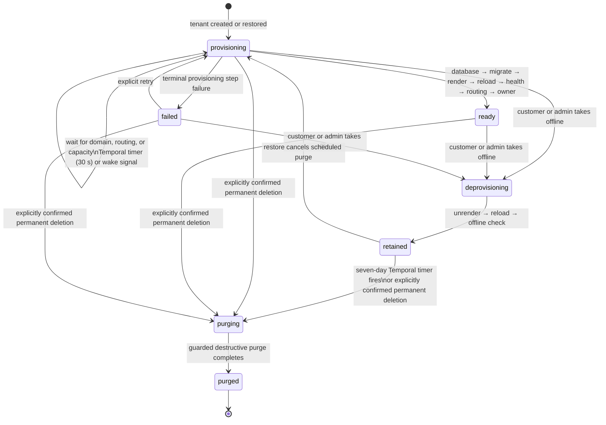

# Tenant lifecycle

PostgreSQL is the source of truth for tenant state. Temporal records durable
workflow progress and timers; it never replaces the tenant row as the authority.
The provision, deprovision, and purge operations are audited separately.

## Durable waiting and retrying

- A provision step that is not ready returns a durable wait outcome. Temporal
  persists a 30-second timer and rechecks that same step; earlier completed
  steps are skipped idempotently.
- A domain activation or lifecycle change sends a best-effort Temporal signal
  to wake the provision workflow immediately. Missing a signal is safe because
  the persisted timer remains.
- Unexpected activity failures use Temporal activity retry. Expected terminal
  provisioning errors are recorded on the tenant, step, and operation instead.
- Long-running provision workflows use continue-as-new after 240 timed waits,
  preventing unbounded workflow histories.

## Retention and destructive purge

Deprovisioning is deliberately non-destructive. A tenant reaches `retained`
only after it is offline; its database, media, configuration, backups, and
Cloudflare resources remain available for restoration. The retention timer is
seven days. Restore clears the scheduled purge in PostgreSQL, so the guarded
Temporal purge activity becomes a no-op even if its timer has already fired.
An immediate purge requires separate explicit confirmation and is audited.
