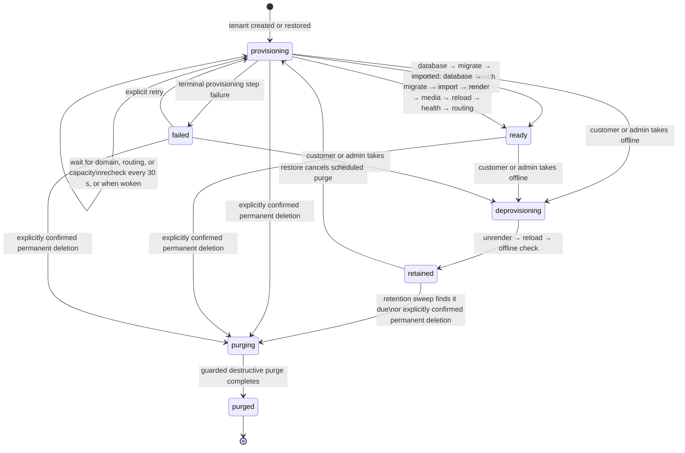

# Tenant lifecycle

PostgreSQL is the source of truth for tenant state, and the record of the work
still to do: each tenant's lifecycle work is a row in `lifecycle_jobs`, requested
in the same transaction as the state change that needs it. The provision,
deprovision, and purge operations are audited separately.

Domains can be reused after purge completes. Disabled, retained, and purging
tenants continue reserving their primary names. Purged records retain their
original names, but no longer prevent another tenant from using them.

## One list of steps, two kinds of tenant

The job iterates every step a tenant can have, in the only order they make
sense in. A tenant without one completes it without running anything: a created
tenant has no `import` or `media`, and an imported one has no `owner`, because
its owner account arrived with its database. Which steps a tenant has is decided
once, in PostgreSQL, when it is created or imported.

The two kinds also wait for opposite things. A created instance with a custom
domain provisions nothing until that domain validates, so an instance whose
domain never validates leaves nothing behind. An imported instance is restored,
rendered, served and checked *first*, and waits only at `routing` — because its
domain is already serving somewhere else, and moving it is the cutover. The
health check reaches the runtime directly with a `Host` header, so it proves the
instance works before any public DNS points at it.

## Durable waiting and retrying

A job holds no position of its own. Every run walks its steps from the first, and
the step tables say which are already done, so resuming after a crash and
checking again after a wait are the same thing.

- A job is claimed under a two-minute lease, which the run renews every twenty
  seconds. A control plane that dies stops renewing, and its jobs are taken up
  again when their leases run out. Sixteen jobs run at once.
- A provision step that is not ready ends the run and sets `run_after` thirty
  seconds ahead. A waiting job holds no slot, however long it waits.
- A step's deadline is for a step that has hung: an hour, or twelve for `import`
  and `media`, which are bounded by how much of somebody's server there is.
  Reaching it kills the step's process and runs the job again.
- A domain activation or lifecycle change wakes the provision job by moving its
  `run_after` to now. Missing a wake is safe because the wait ends anyway.
- A deprovision or purge step that fails is retried a minute apart, ten times,
  and then the operation is left failed for an operator. A provisioning step that
  fails is recorded on the tenant, step, and operation, and waits for a retry.
- A panic is a failure like any other, retried with a backoff of up to 100
  seconds.
- A tenant has one live job of each kind. A request for one that exists runs it
  again from the top, even if it is running now: `generation` counts requests,
  and a run that saw an older one cannot finish the job, because it may have read
  the state from before the request.

A deploy needs no window: a job killed by a restart runs again when its
lease ends, and adding a step needs nothing of the jobs already running.

## Keeping a ready tenant on its configuration

Lifecycle jobs each run once and end. The reconciler does not: it is a loop in
the control plane, and is what makes a configuration change reach a tenant that is already serving.

Every write to `tenant_configuration` bumps the tenant's `config_revision`
through a database trigger, and a render records the revision it came from in
`rendered_revision`. The two differing is the only definition of drift. Once a
minute it renders every ready tenant on its runtime whose revisions
differ, then reloads the runtime once for all of them — a reload makes the
runtime re-read its whole tenants directory, so a fleet that drifted together
costs one signal — and health-checks each tenant it touched.

`runtimes.reconcile_next_at` says when a runtime is next due. A pass moves it past
its own ten-minute timeout on the way in, so only one is ever in flight, and a
minute ahead on the way out. Reconciliation has no job: it is a controller, not
an operation.

What it will not touch:

- A tenant that is not `ready` and `running`. One still provisioning has its own
  job rendering and reloading it; a retained or purging one was taken off
  disk deliberately.
- A runtime on another host. Only the control plane named by
  `CONTROL_RUNTIME_HOST` reconciles a runtime, and the render refuses anyway.
- A tenant that has failed five consecutive passes. The count and the reason sit
  on the tenant row, and an operator's render clears both.

A failed render does not hold back the reload for the rest of the runtime. A
failed reload does: every tenant rendered in that pass gives up its
`rendered_revision`, because a render that recorded its revision would leave no
drift for the next pass to find. Each pass writes one `reconcile` operation per
tenant, with no `requested_by`, which is what tells it apart from an operator's
render in the operations log.

## Changing a ready tenant's domain

A tenant's accounts are ActivityPub actors under its domain, so moving it to
another domain is a migration rather than a setting. Until eunha could send
Moves, a custom domain verified after the tenant had accounts only ever became
an alias. Now a customer or an operator can move a ready tenant to a provided
subdomain or a custom domain, and a `domain_change` job walks it through
six steps, recorded in `domain_changes`:

1. **attach**: the new hostname, with its provided siblings, is added as a
   pending domain and as an alias, so it is served and can be checked before
   anything else changes. The domain reconciler validates it through Cloudflare
   as it does any other. The change waits here, for up to seven days for a
   custom domain, and can be cancelled until it moves on; nothing about the
   tenant has changed yet, so a cancelled or failed attach leaves it where it
   was.
2. **rename**: `eunha rename-domain` rewrites the addresses the tenant has
   handed out under the old domain (its accounts', its posts', its follows').
   Without it, the new domain would serve posts claiming to be from the old
   one, which other servers refuse.
3. **switch**: the new hostname becomes primary, the old one leaves the
   configuration and joins `previous_domains`, and the tenant is rendered,
   reloaded and health-checked under the new domain alone. The old domain stops
   answering here, on purpose.
4. **move**: `eunha accounts move --from OLD --all` queues, as one batch, a Move
   from every account's old actor to its new one for its followers, signed with
   the old key id, which their servers already hold, and a Follow from every
   new actor to whoever the account followed, whose servers would otherwise go
   on delivering to the old one. Each actor names its old self in
   `alsoKnownAs`, because `previous_domains` is rendered into eunha's
   configuration, and that is what a server checks before it honours a Move.
5. **deliver**: the batch is followed with `eunha accounts batch-status` every 30
   seconds until nothing in it is pending. A server that has not taken its
   delivery within twelve hours is given up on, so the change always finishes;
   how many were given up on is recorded, and their users can follow again by
   hand.
6. **release**: the old hostnames are taken off Cloudflare and freed, a
   provided subdomain included, for anyone to take. Whoever takes one next
   answers at the old actors' addresses; a server that missed the Move and
   still follows an old actor would take a new one there for it, once the
   keys it holds stop verifying and it fetches that actor again.

A step that fails after `attach` leaves the tenant part-way moved, and the
change `failed` for an operator. Every step can run again (the rename is a
no-op the second time, and the Moves are not resent once their batch is
recorded), so **Retry** in the console's domains dialog continues from the step
that failed.

## Moving a tenant to another runtime

A tenant's runtime decides which eunha release serves it, and so its release
channel ([releases](releases.md)). An operator moves a ready tenant to another
runtime from the tenant inventory's move dialog. The move is a `runtime_move`
lifecycle job, recorded in `tenant_moves`. It makes before it breaks: the new
runtime serves the tenant before the old one lets it go, so the tenant stays up
throughout. For the minutes in between both processes serve it. Eunha allows
that, because its job queue and scheduler lease what they run in PostgreSQL.

A move is refused unless:

- the tenant is ready, has no other lifecycle work in progress, and is not
  already moving;
- both runtimes are on the instance this control plane manages;
- the new runtime runs the tenant's release or a newer one. Its release migrates
  the database, and an older one would serve a schema it does not know;
- the tenant has no existing (`legacy`) domain. Infrastructure routes one of
  those to the runtime it was set up on, so it has to be managed with Cloudflare
  first;
- the old runtime keeps at least one other tenant. Eunha refuses a tenants
  directory with none, and would go on serving the last one;
- the new runtime's tenants and this one fit within PostgreSQL's connections.

The steps:

1. **migrate**: the tenant's database is migrated with the new runtime's
   release.
2. **start**: its file is rendered into the new runtime's directory, the new
   runtime is reloaded, and the tenant is health-checked there.
3. **switch**: it is rendered again, in case its configuration changed, and
   `tenants.runtime_id` becomes the new runtime. From here the domain reconciler
   points every hostname at the new runtime's origin.
4. **route**: waits until every hostname is routed there, then two minutes more
   for Cloudflare's edge to follow.
5. **stop**: its file is removed from the old runtime, which is reloaded and
   checked no longer to serve it.

`migrate`, `start` and `switch` wait while either runtime is being released.
While a move is open, neither runtime can be released, and the tenant's domain
cannot change.

A step that keeps failing is given three runs. Until `switch` has happened, a
failure or a **Cancel** undoes the move: the tenant's file is removed from the
new runtime, and it stays where it was. Its database stays migrated by the newer
release, which its own runtime gets next. After `switch`, a failure leaves the
move `failed` but open, still holding both runtimes, and **Retry** in the move
dialog continues from the step that failed.

## Watching a job

The tenant inventory in `/admin` shows the kind of the tenant's latest job and the
step it is on, how many times in a row it has failed, and the last failure in a
tooltip. That text is fixed, so no driver error or secret reaches the console.
`operation_events` is the fuller record, and the one an operator acts on.

## Retention and destructive purge

Deprovisioning is deliberately non-destructive. A tenant reaches `retained`
only after it is offline; its database, media, configuration, backups, and
Cloudflare resources remain available for restoration. The retention timer is
seven days. Once a minute a sweep starts the purge of every retained tenant past
`purge_scheduled_for`, deciding each again under its row lock, so a restore wins
over a purge that was about to start.
An immediate purge requires separate explicit confirmation and is audited.
